# Login to form filling

## Tenant login

### Restore a session

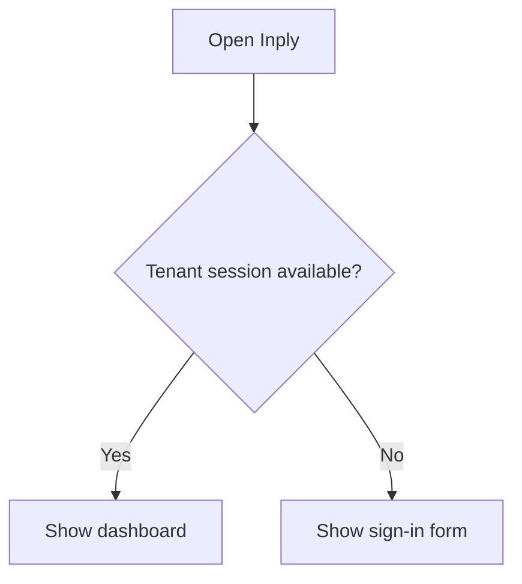

### Sign in

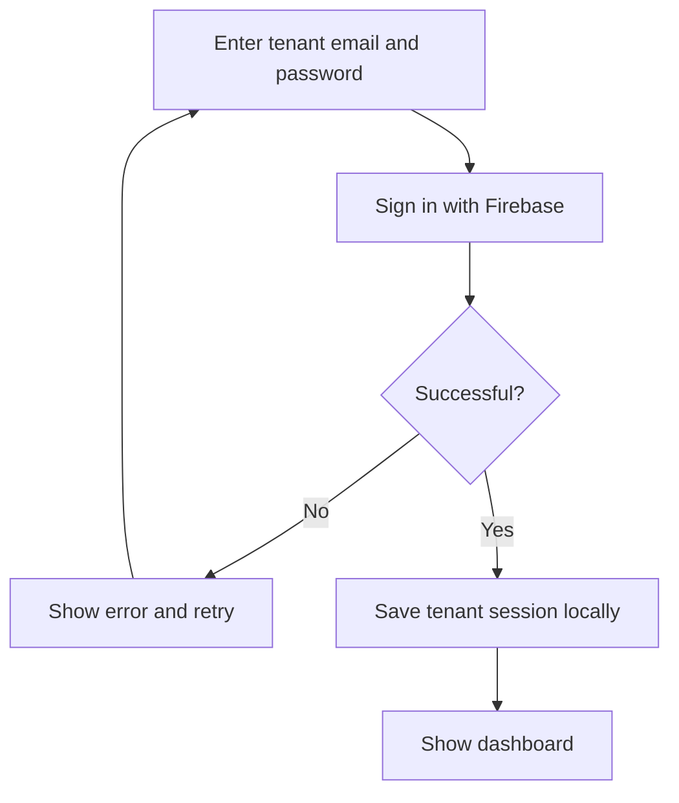

## Customer CRUD

### View customers

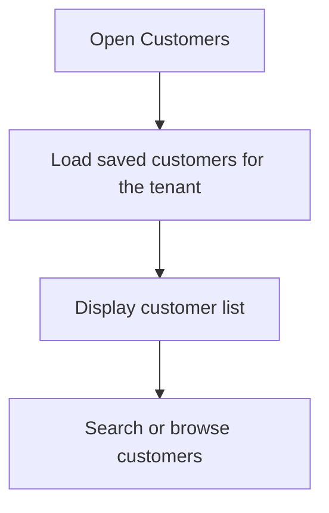

### Create a customer

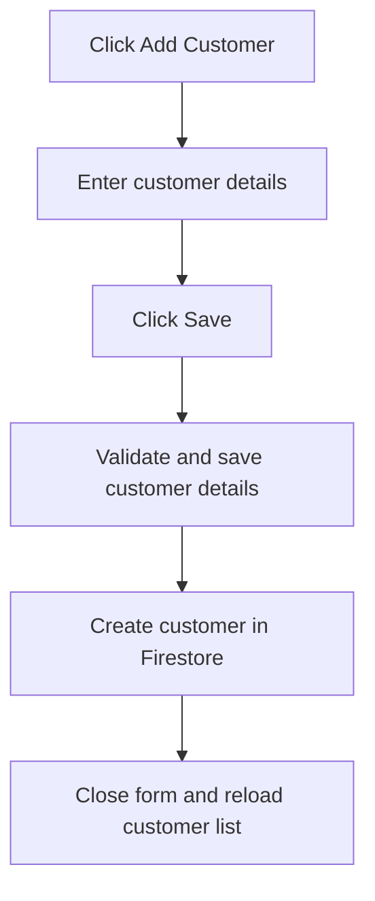

### Update a customer

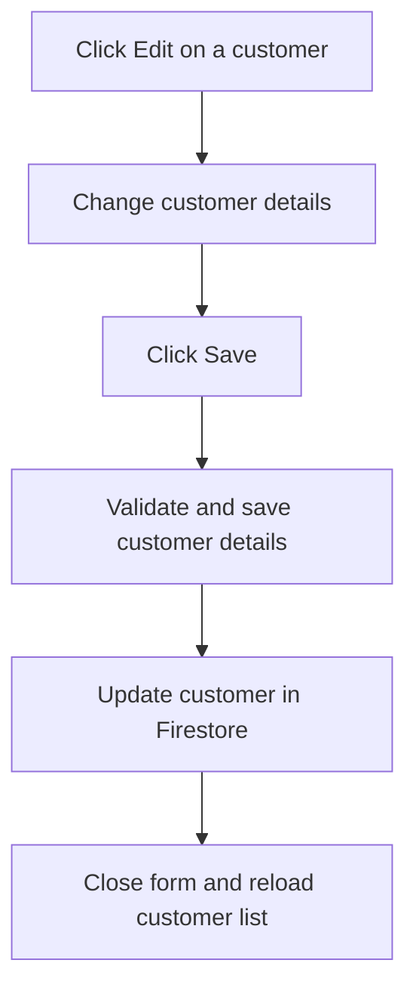

### Validate and save customer details

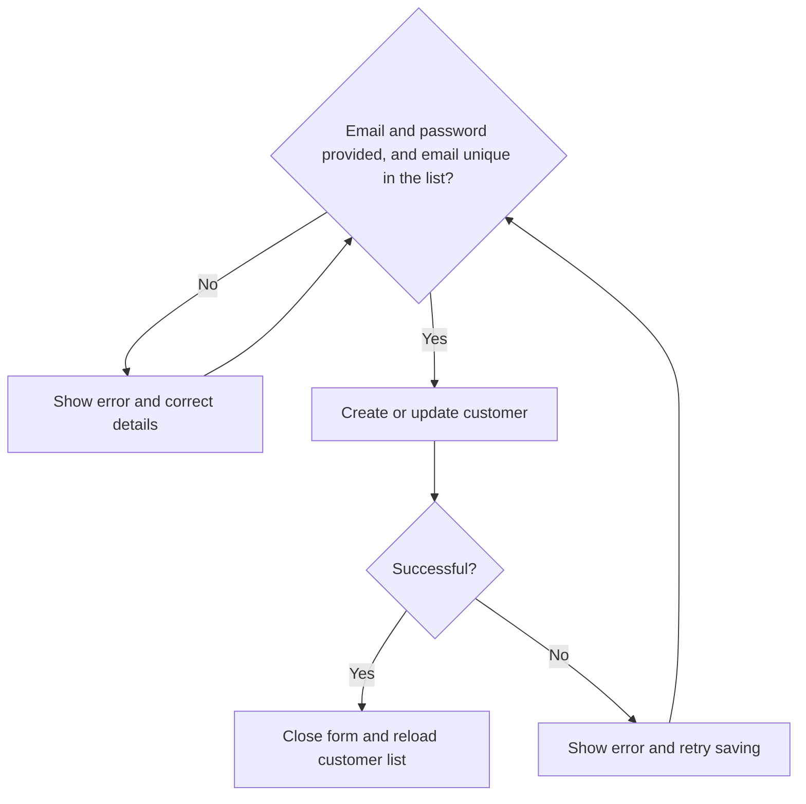

### Delete a customer

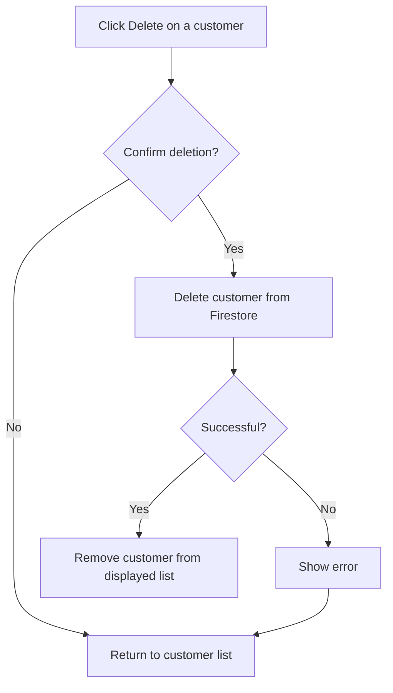

## Customer login

### Start login

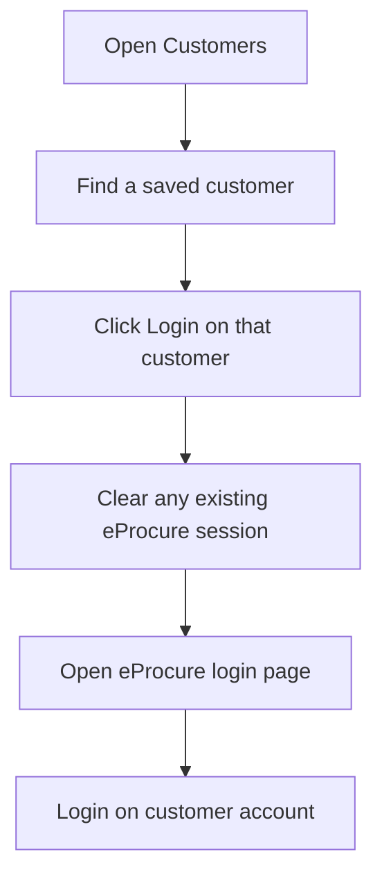

### Submit credentials

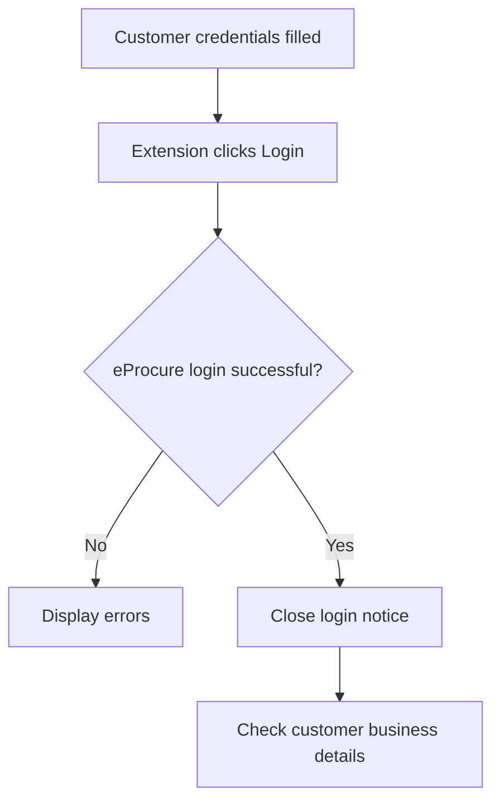

### Collect missing business details

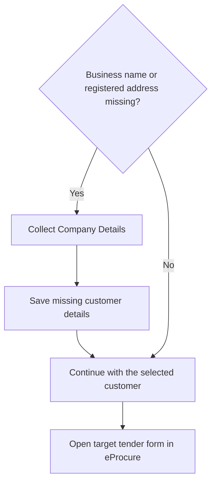

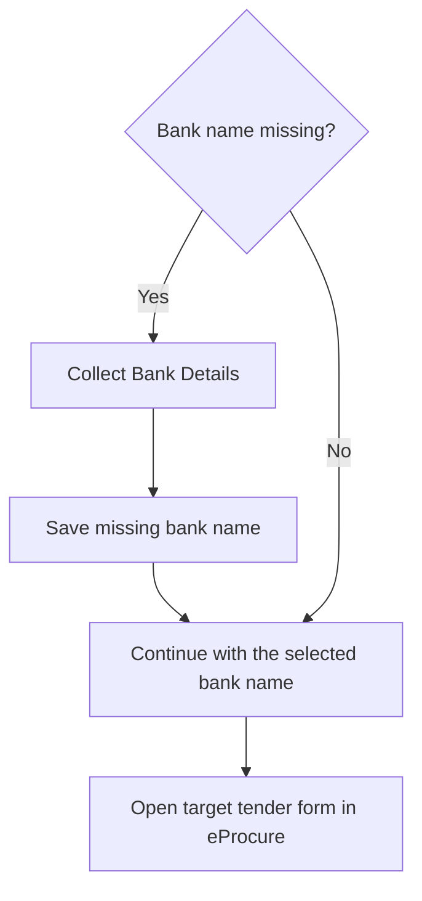

## LTM form filling

### Prepare values

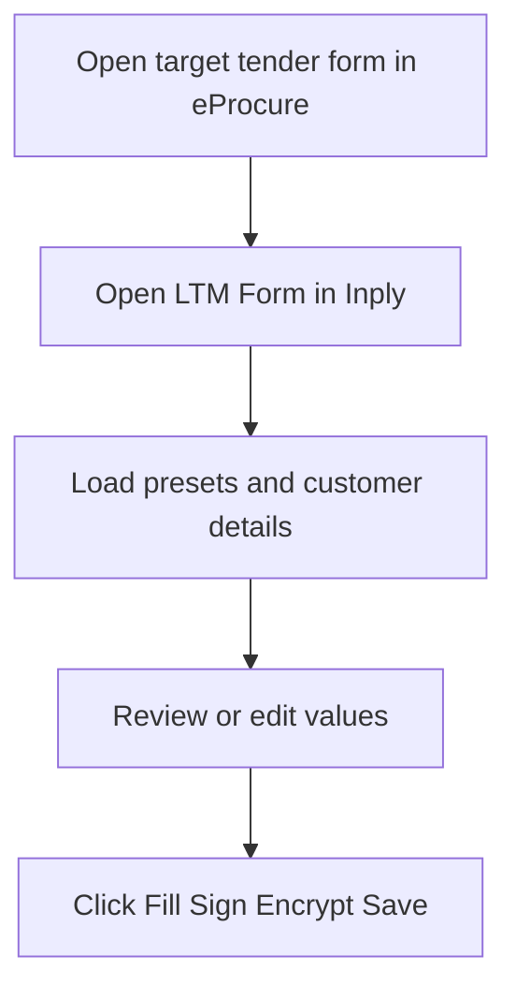

### Check encryption password

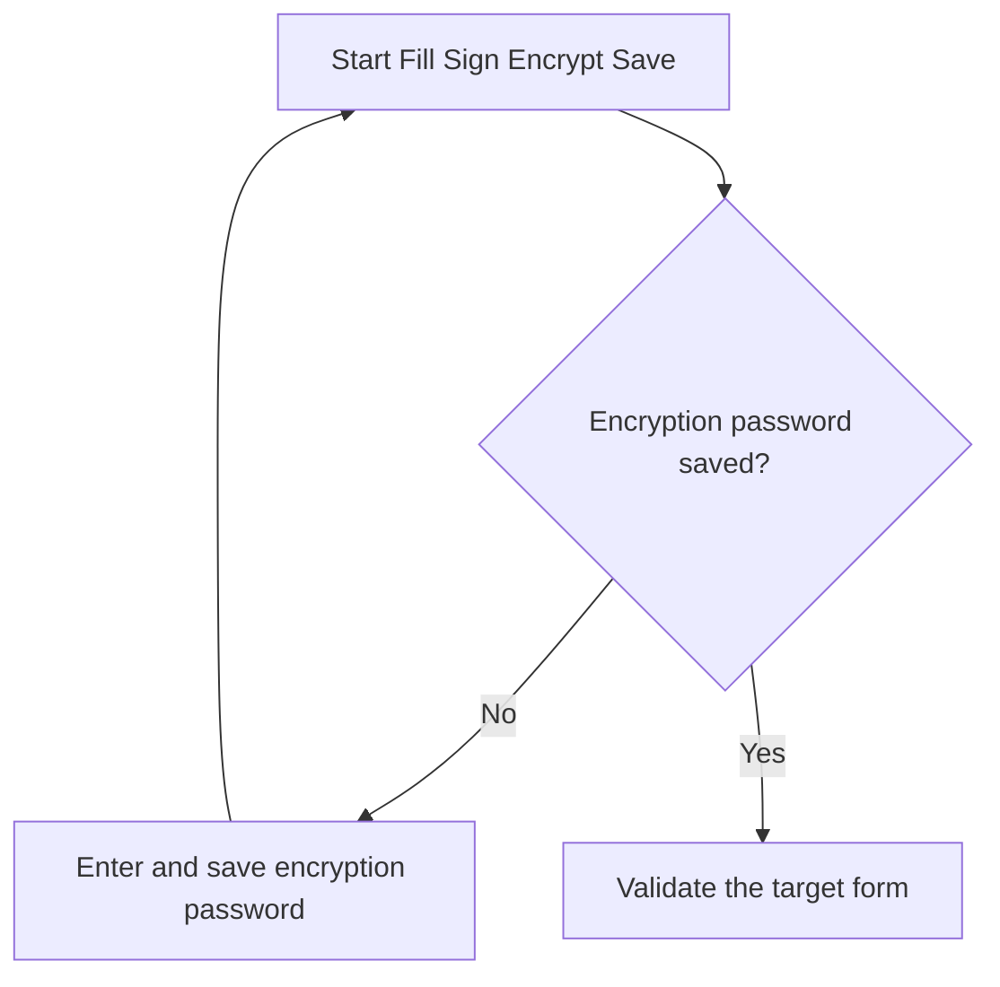

### Validate and fill

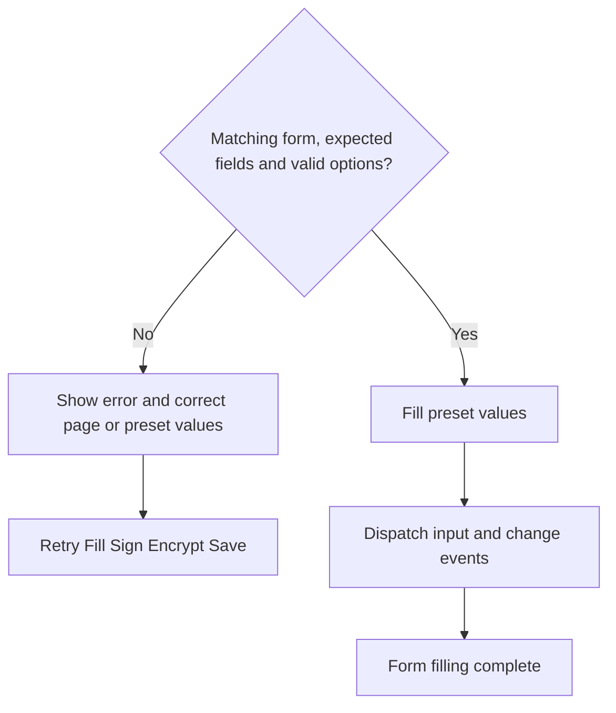

## Saved-rule form filling

### Select a rule

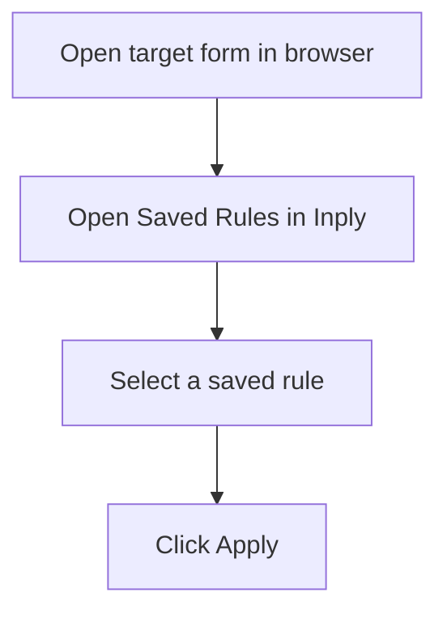

### Find and fill the field

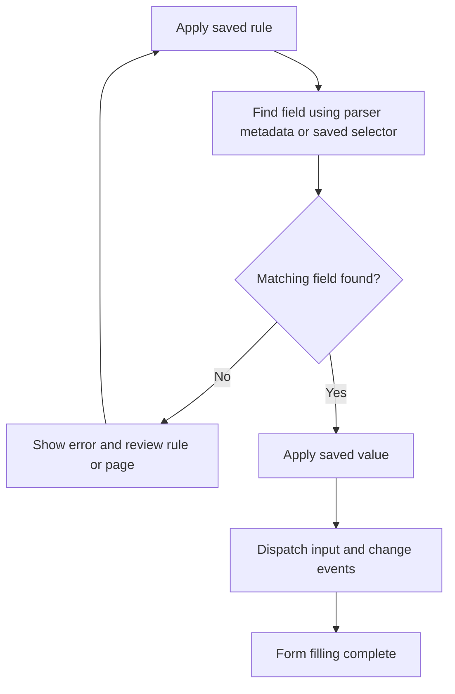
