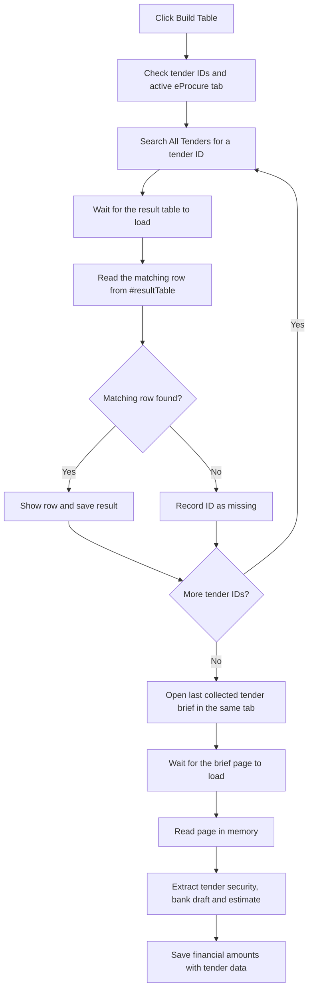

# Tender data collection

The **Build Table** action in a notice collects tender summary data from the
active eProcure tab, saves each successful result, and opens the last collected
tender brief in that same tab. After the brief loads, it reads the page in
memory to extract financial amounts.

## Process

## Implementation details

- `src/components/ui/rule/BuildTableButton.jsx` owns the collection loop and
  table display. It requires the active tab to be an eProcure page that has
  finished loading.
- `clickAllTendersLink` starts the All Tenders search for each ID. The collector
  polls the original tab for up to 30 seconds and reads the row whose tender ID
  matches the requested ID.
- A successful row is added to the displayed table and passed to `onSave`.
  Save errors are reported, but do not prevent later IDs from being collected.
- After collection finishes, the extension finds the last successfully
  collected row, its `tenderBrief_*` link, and matching `viewtenderform_*` form.
  It sets the form target to `_self` and clicks the link. This runs eProcure's
  own `onclick` handler, which submits the tender form in the current tab.
- After navigation, the extension waits up to 30 seconds for the same tab to
  finish loading a new eProcure page and reads its contents in memory. Page text
  and URL are not saved.
- It reads tender security from the lot table's Tender/Proposal Security column.
  It reads Bank Draft from a labeled bank draft field, falling back to Tender/
  Proposal Document Price (In BDT) when that is the available bank payment
  amount. It reads the estimate from a labeled estimated/project cost field.
  Values are saved as `security`, `bankDraft`, and `estimatedCost` and shown in
  the table. The existing `credit` field remains visible and its saved value is
  carried forward when rebuilding the table. Financial amounts are stored as
  numbers; missing amounts are stored as `null` and displayed as a dash.
- When notices load, any previously stored `pageText`, `pageTest`, and
  `pageUrl` fields are deleted from their tender entries in Firestore.
- In the supplied notice markup, the lot security amount is `150000` and the
  document price is `2500`, which is used as the bank draft amount when there is
  no separately labeled bank draft value. The markup has no estimated project
  cost field, so `estimatedCost` will remain blank for that notice.
- If an ID has no matching row, it is reported as missing. If the tender brief
  link cannot be found, collection remains complete and the failure is logged
  to the console. If the detail page does not load or its financial details
  cannot be saved, the summary data remains saved and the issue is reported in
  the console or with a toast.

When a notice has multiple tender IDs, each is searched and saved in sequence.
The final navigation opens the brief for the last ID that was successfully
collected.
